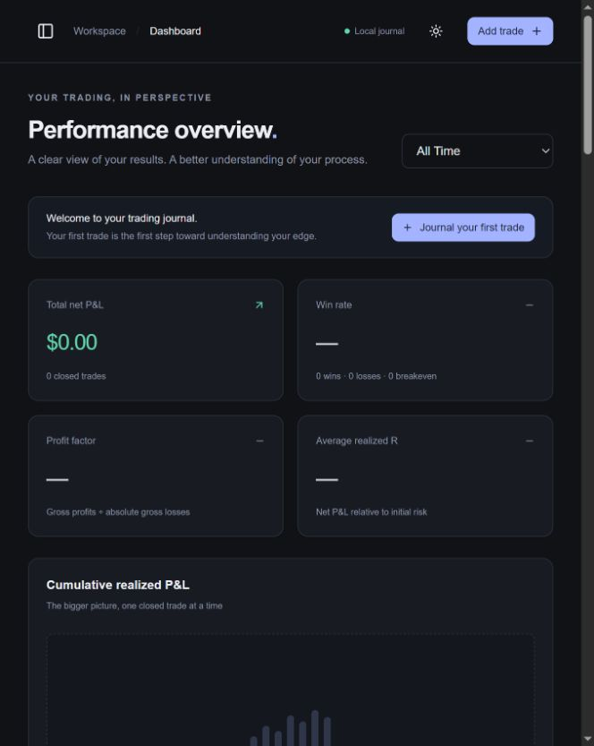

# Forma — Futures Trading Journal

A personal futures trading journal for recording executions, reviewing performance, and building trading discipline. Runs as a Windows desktop app or a local web application, with your records and screenshots stored on your own computer.

**Next.js · TypeScript · React · Tailwind CSS · Electron · Recharts**



## Project highlights

- Trade entry with decimal P&L, fees, risk/reward, and realized R calculations.
- Performance dashboard, daily calendar, analytics, and searchable trade history.
- Screenshot attachments and daily trading reflections.
- Atomic local saves, concurrent-write protection, and recovery snapshots.
- A sandboxed Electron window with a bundled local server and one-time data migration.
- Automated coverage for calculations, dates, persistence, uploads, request boundaries, and desktop migration.

## Run from source

Requires Node.js 24+ and npm. Clone this repository, open its folder, then run:

```sh
npm ci
npm run dev
```

Open **http://127.0.0.1:3000**. No account, API keys, or database setup is required. For a production web build, run `npm run build` followed by `npm start`.

### Build the Windows desktop app

On Windows x64:

```sh
npm ci
npm run build
npm run desktop:prepare
npm run desktop:pack
```

The portable executable is written to `../Forma Journal/Forma Journal.exe`. Double-click it to open the app. The runtime is included. Building requires internet for dependencies and packaging tools; running the finished app works offline. The build is unsigned. Desktop shortcuts are created separately; source builds do not install one automatically.

## Architecture

`src/app` contains the pages and server actions; `src/components` contains the journal UI. `src/lib` holds the trading calculations, analytics, validation, and local file store. `desktop` wraps the production standalone server in Electron. `tests` exercises domain logic and disk-backed storage using temporary data.

This repository contains application source and an empty-journal screenshot. Personal trades, uploaded images, data directories, environment secrets, dependency folders, and generated builds are excluded. It is a single-user local app; hosting it publicly would require a separate authentication and storage design.

## Personal use

Trades, notes, preferences, and screenshots stay on your computer. No Supabase, account, API key, subscription, or cloud deployment is required. Internet access is only needed to install dependencies the first time. The app uses Next.js/TypeScript/Tailwind, Recharts, and Lucide, with a local file database. There are no demonstration trades.

## Open your journal on Windows

**Desktop app:** double-click the **Forma Journal** icon on your desktop. It opens its own window; no browser tab, terminal, Node installation, or setup is needed. Save your changes before closing. Closing the desktop window stops its own background server; opening the icon again brings your saved journal back.

Inside the app, click **Getting started** in the sidebar (or press **F1**) for the simple guide. Start with **Add Trade**, fill in the execution details, then click **Save trade**. Use **Save draft** for incomplete entries. Trade History lets you reopen and edit records; Trading Journal is for daily reflections.

Desktop records are stored under `%APPDATA%\Forma Journal\data`. On first opening, existing records from the earlier local web version are copied there when no desktop journal already exists. The original folder is kept. From then on, use the desktop icon so you are always editing the desktop copy. Choose **Journal → Open data folder** in the menu to find and back up the correct folder.

The portable executable is `../Forma Journal/Forma Journal.exe`. Keep that file in place while using its desktop shortcut. The runtime is bundled; internet is not needed to run it. This personal build is unsigned.

### Earlier browser launcher (optional)

1. Keep this application folder somewhere permanent.
2. **Start Journal.cmd** opens the desktop executable when it is present. Without it, the script falls back to the earlier browser app at **http://127.0.0.1:3000**. That fallback requires Node.js 24 LTS or newer and may install/build on first launch.
3. Start recording trades. Saves are written to your computer immediately; closing the browser does not erase them.

The launcher starts the server in the background. **Stop Journal.cmd** stops this copy's server without deleting your records. **Open Data Folder.cmd** opens the default data folder. If port 3000 belongs to another application or a different journal copy, close it before launching this one.

You can also run from a terminal:

```powershell
npm ci
npm run build
npm start
```

For development, use `npm run dev`. Normal start/development commands bind to **127.0.0.1**, so the journal is available on this computer only. Framework telemetry is disabled by the supplied launcher and npm scripts. Keep the server running while using the journal.

## Where your data lives

Desktop builds use **%APPDATA%\Forma Journal\data**. The browser version uses **data**, directly inside the source folder. Both contain:

```text
data/
  journal.json        Trades, reflections, profile, preferences, instruments
  journal.json.bak    Previous valid metadata snapshot
  screenshots/        Original screenshot files
```

The exact folder appears in Settings. All these files are ignored by Git and excluded from the source ZIP. Clearing browser cookies/cache or reinstalling node_modules does not remove them. Removing the application's data folder does.

For an alternate location, set the `FORMA_DATA_DIR` environment variable to an absolute folder path before starting the app. The default launch scripts require no environment file. If you choose an alternate location, use the path shown in Settings when opening or backing up your files.

### Back up your journal

1. Close the browser and run **Stop Journal.cmd**.
2. Copy the **entire data folder** to another drive or backup location.
3. Restart with **Start Journal.cmd**.

To restore, stop the journal, preserve a copy of the current data folder, and replace it with your saved complete folder. The `journal.json.bak` file is only the previous metadata snapshot, not a complete image backup. If `journal.json` becomes damaged, the app reports an error and does not overwrite it with an empty journal. Restore from your backup or copy `journal.json.bak` to `journal.json` with the journal stopped.

Confirmed deletions also remove the deleted records from the app-managed metadata snapshot. Copies you made elsewhere are unaffected. If a crash leaves the app reporting that the journal is busy, stop all journal servers first; only then remove abandoned `.write.lock` and `.recovery.lock` files from the data folder and restart. Never remove these locks while a journal server is saving.

CSV/JSON exports in Settings contain records and screenshot metadata; they do not include original image bytes. Use a complete folder backup when you want the screenshots too. When upgrading or moving the app, keep and copy your data folder.

## Features

- Manual one-entry/one-exit futures trades; incomplete drafts, open trades, editing, and confirmed deletion.
- Decimal calculations for long/short P&L, total commissions/fees, documented adjustments, initial risk, planned reward/risk, realized R, points/ticks, and duration.
- NQ, MNQ, ES, MES, GC, MGC, CL, MCL, and custom instruments. Trades preserve their saved contract specifications.
- Screenshot browse/drop/paste, previews, full-size viewing, saved captions, replacement, and deletion. PNG/JPG/WebP; up to 10 MB per image or a lower limit in Settings.
- Searchable/filterable/sortable history; dashboard, calendar, and profitability/time/instrument/risk/discipline analytics.
- Daily reflections with attachments, one per date; custom emotion and mistake labels.
- Profile, timezone, currency formatting, light/dark theme, exports, and confirmed journal-data deletion.

Closed trades realize on their **exit date in your configured timezone**. History filters use the explicitly entered trade date. Draft/open trades never enter realized P&L. Missing stops leave risk/R metrics unavailable. Breakeven trades count in the win-rate denominator and reset win/loss streaks. Drawdown measures cumulative realized results, not account equity. Currency changes formatting, not exchange-rate conversion; standard contracts calculate USD results. Prices must be positive in this version.

Entry-time analytics use labeled local clock windows: 00:00–06:59, 07:00–09:29, 09:30–15:59, 16:00–23:59. These are not exchange holiday/session calendars. For repeated DST times, the earlier occurrence is used; nonexistent local times are rejected.

## Local storage behavior

Saves validate inputs, lock the database, write a temporary file, and atomically replace journal.json. A previous valid metadata snapshot is retained. Screenshot paths use validated IDs; image data is checked server-side and never served from a public static folder. Retried uploads use stable image IDs. Non-loopback hosts and cross-origin mutations are rejected.

This is one personal workspace. There is no account password or app-level encryption. Disk files use your computer account's permissions; software or other users who can access the running local server can use the journal. It is designed for your own computer, not a shared machine, shared hosting, cloud deployment, or a network drive with unreliable locking.

## Checks

```powershell
npm test
npm run lint
npm run typecheck
npm run build
```

Tests cover trading calculations, analytics, dates/DST, exports, local persistence/concurrency/corruption handling, attachment validation, and request-origin protection. No external database is needed. Earlier Supabase design documents in docs describe the original version; **docs/local-conversion-plan.md** supersedes their backend, authentication, and deployment requirements.

Contract sources: [CME Micro E-mini specifications](https://www.cmegroup.com/articles/faqs/micro-e-mini-equity-index-futures-frequently-asked-questions.html), [CME Gold specifications](https://www.cmegroup.com/trading/metals/files/fact-card-gold-futures-options.pdf), [CME Micro WTI specifications](https://www.cmegroup.com/education/articles-and-reports/micro-wti-crude-oil-futures-faq).
